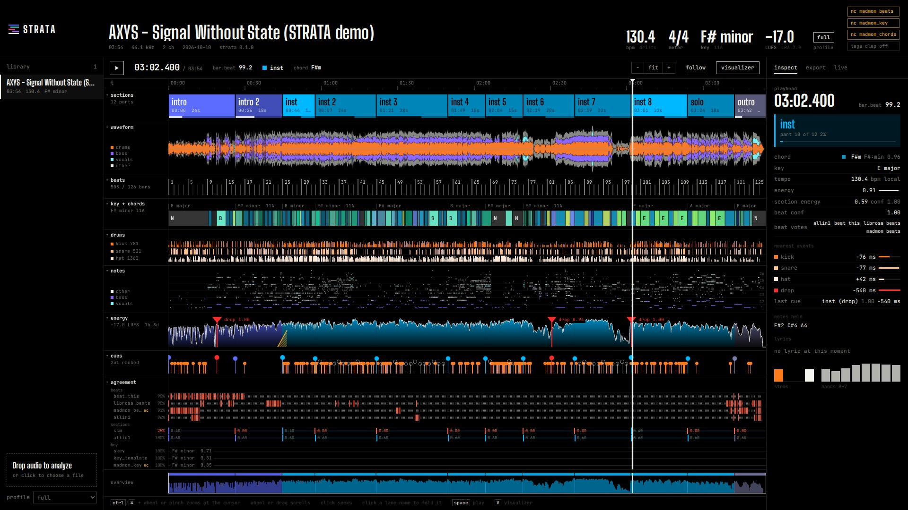
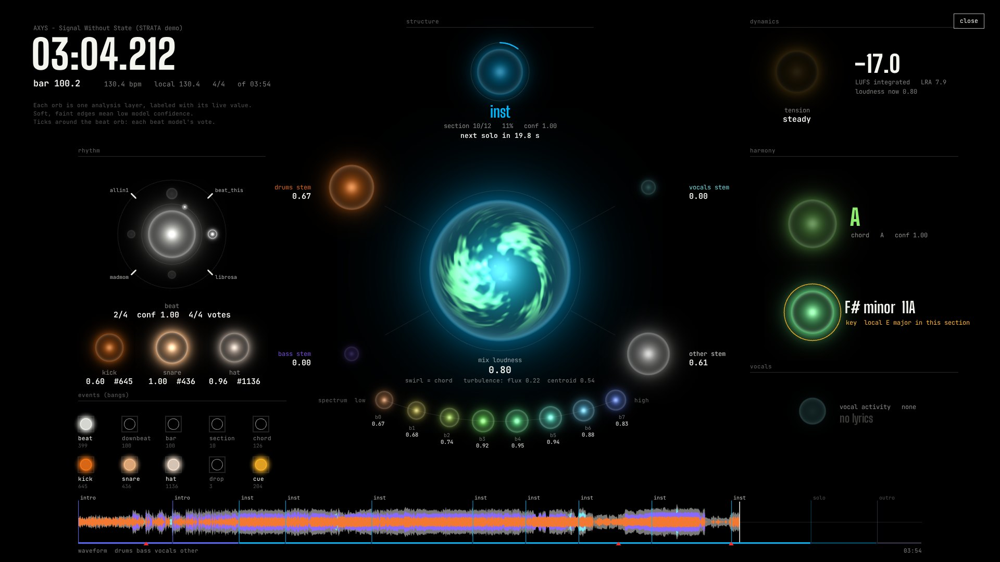

# STRATA

**Ensemble music analysis for people who cut and perform to music.** Drop in a track and get every layer as one JSON, then drive edits, live visuals and code from it.





Sections · tempo map · beats/downbeats/bars · key + local keys · chords · kick/snare/hat · notes per stem · loudness/LUFS · builds & drops · vocal activity + timed lyrics · ranked cue points · 20 per-frame curves.

Each dimension runs several open-source models and **votes**. Every beat and boundary carries its confidence and which models agreed, and the UI shows disagreement directly.

```bash
strata analyze song.wav --export all     # analysis.json + Premiere/Resolve/AE/MIDI/CSV/texture/report
strata query song.wav --cues --min 0.6   # structural cut points
strata live song.wav --osc 127.0.0.1:9000  # play it as OSC into Notch / TouchDesigner / Resolume
strata serve --open                      # color-coded timeline + visualizer at :3090
```

Try it without a GPU: `strata serve --open` loads the bundled demo, **AXYS: "Signal Without State"**, with its precomputed analysis.

## Install (Linux / WSL, NVIDIA GPU recommended)
```bash
uv venv -p 3.12 .venv && source .venv/bin/activate
uv pip install torch torchaudio --index-url https://download.pytorch.org/whl/cu128
uv pip install -e vendor/all-in-one        # allin1 with the pure-PyTorch neighborhood attention (PR #39)
uv pip install --no-deps basic-pitch "git+https://github.com/deezer/skey.git" && uv pip install nnAudio
uv pip install cython && uv pip install -e ".[dev,lyrics]"
(cd ui && npm install && npm run build)
strata doctor
```

## Profiles and licenses
STRATA's code is MIT. madmom's neural models carry **non-commercial** weights. They are marked `nc` everywhere and excluded by `--profile commercial-safe`. See [THIRD_PARTY.md](THIRD_PARTY.md).

## Exports
| format | file | for |
|---|---|---|
| json / csv | analysis.json, beats/sections/chords/events/cues/curves.csv | code, sheets, TouchDesigner CHOPs |
| midi | strata.mid | DAWs: tempo map, section markers, chords, GM drums, notes per stem |
| labels | audacity.txt, reaper_regions.csv | Audacity, Reaper |
| premiere | premiere.xml | Premiere (FCP7 XML sequence + markers) |
| fcpxml / edl | timeline.fcpxml, resolve_markers.edl | Resolve, Final Cut |
| ae | strata_ae.jsx | After Effects: comp, markers, keyframed curve sliders |
| texture | curves.png/.npy | shaders, Notch, TD |
| report | report.html | single-file shareable breakdown |

Design: `docs/superpowers/specs/2026-10-10-strata-design.md`.
